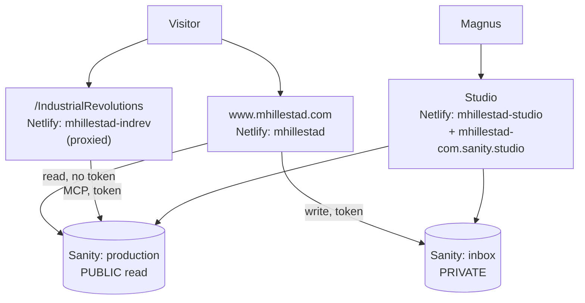

# System architecture

How the pieces of mhillestad.com fit together, and why they are arranged this
way. The chat bot is covered in the most depth, because it is the part with
non-obvious engineering in it.

- [The whole system](#the-whole-system)
- [The content layer (Sanity)](#the-content-layer-sanity)
- [The main site (`www`)](#the-main-site-www)
- [The chat bot (`industrialrevolutions`)](#the-chat-bot-industrialrevolutions)
- [Known drift](#known-drift)

---

## The whole system

A monorepo deployed as three Netlify sites, all reading one Sanity project
(`301op25o`).



| Folder | Netlify site | What it is |
|---|---|---|
| `www/` | `mhillestad` | The CLI-style personal site. Astro, mostly prerendered. |
| `industrialrevolutions/` | `mhillestad-indrev` | "Canal Mania & the Philosophers Stone" — the AI chat bot. Astro SSR. |
| `studio/` | `mhillestad-studio` | Sanity Studio. Also deployed to `mhillestad-com.sanity.studio`. |

The chat bot is served at `www.mhillestad.com/IndustrialRevolutions` through a
Netlify proxy rewrite, which is why it is built with
`base: '/IndustrialRevolutions'`.

---

## The content layer (Sanity)

Project `301op25o`, **two datasets with deliberately opposite access rules**.

| Dataset | ACL | Holds |
|---|---|---|
| `production` | **public** | The site: commands, pages, entries, books, podcasts, investments, KB sources. |
| `inbox` | **private** | Contact form submissions — names and email addresses. |

This split is load-bearing, not tidiness. `production` is public-read: every
document in it is fetchable by anyone with no token, which is what lets the
build read content without credentials. It also means **anything written there
is published, not stored** — so visitor details go to `inbox`, which requires a
token to read.

> Never add `contactMessage` to the default workspace, and never write a
> submission to `production`.

The Studio therefore has **one workspace per dataset** (`/content` and
`/inbox`). Sanity requires every workspace `basePath` to have the same number
of segments, which is why the main workspace sits at `/content` rather than `/`
and the Studio root shows a picker.

### Schema shape

The command surface is content, not code. The `homepage` document holds an
ordered array of command references — **a command missing from that array does
not exist on the site**, regardless of whether its document exists.

Listings follow one of two ordering rules:

- **Self-sorting**: `entry` by date, `book` by author, `podcast` by title. There
  is nothing to drag.
- **Editorial**: investments are dragged into groups on `homepage`.

`book` carries `showOnSite`, defaulting to off, so the reading list in Sanity is
a superset of what the site prints. The filter lives in the GROQ projection, so
a hidden book never reaches the browser at all.

---

## The main site (`www`)

Astro with the Netlify adapter. The home page is **prerendered** — visitors get
a static file off the CDN — while preview routes and the contact endpoint are
server-rendered.

```
src/lib/sanity.ts      one GROQ query → all content, plus types
src/lib/render.ts      block content → terminal HTML (build time)
src/lib/outputs.ts     command registry → what the terminal needs
src/components/        TerminalShell.astro — the interactive terminal
src/pages/api/contact  the only route holding a write token
```

**Everything is rendered at build time.** `renderBody` turns Sanity block
content into HTML strings that are embedded in the page, so the terminal is
instant and works offline — no runtime request to Sanity. Content changes reach
the site through a Sanity webhook that triggers a Netlify rebuild.

`renderBody(body, ctx)` takes a `RenderContext` (`groups`, `entries`, `books`,
`podcasts`) rather than a growing parameter list, so a new kind of listing is
one field instead of an edit to six call sites.

### Command dispatch and filters

The terminal dispatches on the whole input line. Filters like `blog -talks` are
**pre-rendered variants**, not runtime filtering: `buildTerminalData` emits
`variants[command][word]` for every command whose body contains a listing, and
the browser only picks which one to show. Dashes and whitespace are stripped
before lookup, so `-talk`, `-talks`, `--talk` and `- talk` are one request; an
unrecognised filter names the ones that exist.

### The contact form

`contact` is a builtin (like `snake`) because it needs a submit handler and a
network call, which block content cannot express.

```
terminal form → POST /api/contact → validate → Sanity mutate → inbox
```

The endpoint revalidates every field server-side, caps lengths, stamps
`submittedAt` itself rather than trusting the browser clock, and logs Sanity's
errors without ever returning them to the visitor. A honeypot field and a
one-second minimum fill time answer **200** to bots, so they record success and
stop varying the payload. That stops bots, not a determined human.

> **The write token must be read from `process.env`, never `import.meta.env`.**
> Vite inlines `import.meta.env` at build time, which bakes the literal token
> into the deployed bundle; Netlify's secret scanning then fails the build. A
> runtime secret has to stay a runtime lookup. The env var is scoped to
> `functions` only so it is not present during builds at all.

---

## The chat bot (`industrialrevolutions`)

A chat-only site where a resident AI expert discusses AI through the lens of the
industrial revolutions. Astro 7, `output: 'server'`, Netlify adapter.

```
src/pages/index.astro     chat UI, consumes SSE, renders markdown client-side
src/pages/api/chat.ts     the whole server: streaming endpoint          (419 lines)
src/lib/personas.ts       system prompts + ENABLED_PERSONAS             (103)
src/lib/knowledgeBase.ts  MCP outline cache + tool-call fallback        (187)
```

**The server is stateless.** There is no session store — the browser POSTs the
entire transcript each turn and the server validates it. Conversation state
lives in the client.

### Request lifecycle

```
browser POSTs transcript
  → validate: ≤40 messages, ≤2000 chars each,
    first and last must be `user`, speakers must be known personas
  → per-IP rate limit (8 / 60s, in-memory Map — resets on cold start)
  → require ANTHROPIC_API_KEY; require MCP config unless KB_OPTIONAL
  → preload knowledge-base outline (cached per instance, 1h TTL)
  → return an SSE ReadableStream:
       moderator picks speaker(s)     [skipped when one persona is enabled]
       for each speaker: stream reply, append to transcript
       later speakers see earlier replies from the same turn
```

SSE events: `speaker`, `searching`, `delta`, `agent_done`, `notice`, `error`,
`done`.

### The core choice: MCP connector, not an agent loop

Grounding comes from the **Sanity MCP server**, but this code never runs a tool
loop. It passes `mcp_servers` to the Anthropic API (beta
`mcp-client-2025-11-20`) and **Anthropic connects to Sanity server-side** and
executes the lookups itself. Model: `claude-haiku-4-5`, chosen for cost.

That one decision removes most of what would otherwise be agent-framework code.
What remains is the handful of cases the connector does not cover — and that is
where the real engineering is.

### Three problems worth understanding

**1. Latency — outline preloading.** Sanity's MCP exposes `initial_context` (a
~10k-token outline of the whole knowledge base) and `knowledge_base_read`. Left
to itself the model calls them in sequence: two round trips per message, ~11s,
most of it that dance. Instead the outline is fetched once per server instance
and injected as a system block marked `cache_control: ephemeral`, so the API
reuses it across requests rather than re-reading it every time.

> **~11s → ~5s.** Refetched hourly so knowledge-base edits land.

**2. Narration leaking to the visitor.** The model likes to announce a search
("I'll look that up…") before running one. Text accumulated before a tool call
is discarded — `full = ''` when an `mcp_tool_use` block starts — but if the
model narrates and then *stops without searching*, nothing clears it, and the
visitor is left reading a promise and asking "did you find it?".

So there is a `NARRATION` regex requiring **both** an intent opener and a lookup
verb (so "Let me be clear…" passes), one nudge handing the model its own words
back, and if it still narrates the reply is **discarded and treated as a
failure** — an empty reply surfaces an error, which is better than showing a
promise to go and look. Capped at one retry: chaining them once took a reply to
79 seconds, and slower is its own kind of broken.

**3. Malformed tool arguments.** The model sometimes emits `paths` as a
JSON-encoded string instead of an array. The connector cannot execute that, so
it arrives as an ordinary client-side `tool_use` — a dead turn. `callTool` runs
it locally over raw JSON-RPC, `repairArgs` coerces the string back to an array,
the result is handed back, and the model carries on.

> A landmine documented in `outlineBlock`: describing the read tool's arguments
> in prose — *even correctly* — is what makes the model stringify `paths`.
> Saying nothing and letting the tool's own schema speak fixes it.

Plus `pause_turn` handling (append the partial assistant turn, re-send, up to 4
continuations) and an empty-reply fallback that retries *without* the preloaded
outline before giving up.

### Failure philosophy: fail closed

If the MCP server is unconfigured or unreachable, **the experts refuse to
answer** rather than falling back on general knowledge. `KB_OPTIONAL=true` is a
local-development escape hatch only.

The persona prompts reinforce it: never mention tools, searches or technical
problems to the visitor, and if the knowledge base genuinely lacks a topic, say
that plainly — not that something went wrong.

### Personas

Three are defined; **one is enabled**.

| id | name | scope |
|---|---|---|
| `guide` | The Guide | both the industrial revolutions and the AI revolution |
| `historian` | The Historian | the industrial revolutions |
| `technologist` | The Technologist | the AI revolution |

With a single entry in `ENABLED_PERSONAS` the moderator call is skipped
entirely. Set two or more and multi-expert mode returns: a JSON-schema-
constrained moderator call routes each message, speakers run in order, and each
sees the previous reply, so they react to one another within a single turn. The
UI and header byline read from `ENABLED_PERSONAS`, so nothing else changes.

### Abuse guards

Public, no login: 2,000 chars per message, 40 messages per transcript, 8
requests per minute per IP. The rate limiter is in-memory, so it resets on
redeploy or cold start — adequate for a hobby site, not a real defence.

Model output is untrusted and rendered as a small markdown subset client-side,
re-rendered from scratch on every update.

---

## Known drift

Things that are true of the code but not of the docs, or vice versa.

- The `sanity` command claims the company is hiring. True at the time of
  writing, but it will go stale silently — it is content, so it can be edited in
  the Studio.

### Traps worth remembering

- `netlify --site <name>` from the repo root **silently targets whatever this
  directory is linked to** (`mhillestad-indrev`), not the site you named. Use
  `NETLIFY_SITE_ID=<id>`.
- `netlify env:set --secret` requires an explicit `--context`, or it reports
  success while storing nothing.
- Deploying schema (`npm run schema:deploy`) is **not** the same as deploying
  the Studio (`npm run deploy`). The first updates what MCP and agents read; the
  second rebuilds the app you click around in. A new document type needs both.
